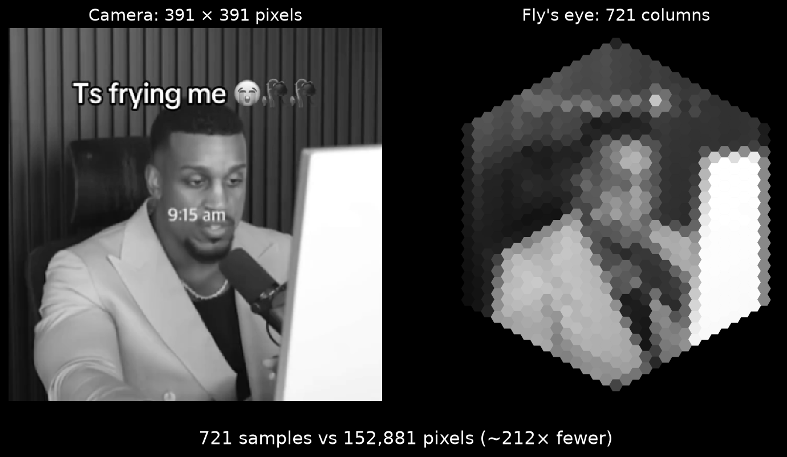
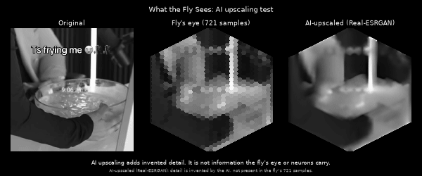
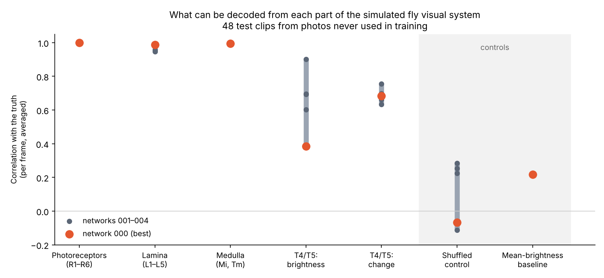

# What the Fly Sees

**What visual information survives in a connectome-constrained model of the fruit fly's motion-vision pathway?**

We run video through **flyvis** (Lappalainen et al., *Nature* 2024): a model of the fly's visual system wired from its measured connectome, with 45,669 neurons of 64 cell types and parameters trained on a motion task. The video is first sampled onto the fly's 721-column hexagonal eye, then simulated through the network. Linear decoders then ask how much of the picture each stage of the pathway still carries.

> The reconstructions are decoded from **simulated** neurons. They show what information survives in the model, **not what the fly experiences**.

## Demo

**[Open the demo page →](demo/)**

| The fly's eye is coarse | The fly's eye vs AI upscaling |
|---|---|
|  |  |
| Our clip: 721 samples instead of 152,881 pixels (about 212× fewer). | Any sharper detail in the AI panel is invented by the AI (Real-ESRGAN), not carried by the fly's eye. |

## Results



Score: per-frame correlation between decoded and true brightness across the 721 columns, averaged over frames. Test clips use photos never seen in training. The table shows network 000 (the best of flyvis's 50 pretrained networks) and the range over networks 000–004.

| Decoder group | Train | Test (unseen photos) | Test (synthetic) | Range, 5 networks (unseen photos) |
|---|---|---|---|---|
| Photoreceptors (R1–R6) | 1.000 | 1.000 | 1.000 | 0.999–1.000 |
| Lamina (L1–L5) | 0.977 | 0.989 | 0.971 | 0.948–0.992 |
| Medulla (Mi, Tm) | 0.992 | 0.996 | 0.984 | 0.989–0.997 |
| Motion detectors (T4/T5): brightness | 0.293 | 0.385 | 0.275 | 0.385–0.902 |
| Motion detectors (T4/T5): brightness change | 0.677 | 0.683 | 0.712 | 0.633–0.756 |
| Shuffled control | 0.074 | −0.066 | −0.065 | −0.112–0.285 |
| Mean-brightness baseline | 0.307 | 0.218 | 0.280 | same for all |

**What we found**

- **The picture survives the early stages.** Linear decoders recover it from the lamina and medulla at 0.95 or better.
- **The motion detectors carry change more than brightness.** "What changed" decodes from T4/T5 at 0.63–0.76 in every network. How much plain brightness leaks into T4/T5 varies widely between networks (0.39–0.90).
- **Still scenes don't go fully quiet.** Brightness decoded from T4/T5 on still photos still correlates 0.49–0.91 with the truth. The decoder is linear with no memory of scenes, so this reflects static brightness carried by T4/T5 in these models.
- **One caveat on network 000:** on synthetic clips, its T4/T5 brightness decoder (0.275) only ties the mean-brightness baseline (0.280).

**Sanity checks** (each network must behave like a fly's visual system before we trust its decoders):

| Network | Gray stays flat | R1 tracks input | ON edge: T4 > T5 | OFF edge: T5 > T4 | Settles |
|---|---|---|---|---|---|
| 000 | pass | pass | pass | pass | pass |
| 001 | fail (slow drift) | pass | pass | pass | pass |
| 002 | fail (slow drift) | pass | pass | pass | fail |
| 003 | pass | pass | pass | pass | pass |
| 004 | pass | pass | pass | fail | fail |

The failures come from slow cell types in those trained networks (time constants up to about 0.5 s). They persist at flyvis's own 5 ms step, so they're properties of the networks, not of our pipeline.

## How it works

1. **Clips → fly's eye.** Each frame is converted to grayscale and cropped to 391 × 391 pixels. flyvis's `BoxEye` then averages a 13 × 13 pixel box at each of 721 hexagonal column centres.
2. **Simulation.** The eye movie runs through a pretrained flyvis network in 10 ms steps after a 1 s fade-in. Outputs are graded voltages for all 45,669 neurons.
3. **Decoding.** For each group of cell types, one ridge-regression decoder is shared across all 721 columns. Its features are the group's activity over the last 50 ms, standardised. It predicts the brightness (or brightness change) each column received.
4. **Controls.** The decoders are compared against a shuffled control (activity paired with the wrong clip) and a mean-brightness baseline.

## What's in this repo

**`fly_vision_run/`: the decoder pipeline (Steps 1–9).** It's also uploaded as `fly_vision_run (1).zip`.

flyvis's pretrained networks download from Google Drive, which the run environment couldn't reach. So the pipeline rebuilds the model in numpy from published sources. It uses flyvis 1.2.0's own connectome file, with the trained parameters of all 50 networks from the `flycns` package. Each piece is checked: neuron and connection counts match flyvis exactly, and the dynamics match flycns's reference engine to 1.9e-6. Training used 14 photos; tests used 3 photos never seen in training, plus synthetic clips. See [`fly_vision_run/README.md`](fly_vision_run/README.md) to rerun it.

| File | What it does |
|---|---|
| `flyeye.py` | lattice builder, trained-parameter loader, eye, batched simulator |
| `check_parity.py` | checks the simulator against flycns's reference engine |
| `clips.py`, `make_clips.py` | training and test clips |
| `sanity.py` | sanity checks → `sanity_results.json` |
| `decode.py` | trains and scores decoders for one network → `decode_000.json` … `decode_004.json` |
| `summarize.py` | score table (`score_table.json`) and chart (`decoder_scores.png`) |
| `demo.py` | demo video on held-out photos |

**`flyvis_official_check.ipynb`: does the rebuild match the real flyvis?** It runs the official flyvis package on the same test stimuli and compares the numbers row by row. Run it in Colab.

**Root scripts: footage, fly's-eye rendering, demo video, AI upscaling, write-up.** These use the official flyvis package (Python 3.9–3.12).

| Script | What it does |
|---|---|
| `prep_clips.py` | phone videos → 391 × 391 grayscale clips (`clips/*.npz`) |
| `hex_render.py` | shared eye rendering, hex coordinates and plotting |
| `orientation_test.py` | checks the hex plots aren't mirrored or rotated → `results/orientation.json` |
| `coarseness.py` | the "how coarse is it" image |
| `make_demo.py` | four-panel demo video from a decoder payload (`results/demo_payload.npz`) |
| `make_fake_payload.py` | stand-in payload for testing the video layout (not model output) |
| `enhance_flyeye.py` | AI upscaling test (Real-ESRGAN vs bicubic, with a similarity metric) |
| `sanity_checks.py`, `flysim.py`, `looming_bonus.py` | sanity checks and a looming-vs-sliding figure with official flyvis |
| `build_writeup.py` | builds a write-up from the result files and prints a submission checklist |
| `test_logic.py` | unit tests: `python -m pytest -q test_logic.py` |

Colab step-by-step guides: [`colab_cells.md`](colab_cells.md) (footage and demo) and [`colab_cells_C.md`](colab_cells_C.md) (sanity checks and write-up).

**`demo/`:** the presentable outputs. See [`demo/README.md`](demo/README.md).

## Quick start

```bash
# footage and fly's-eye images (official flyvis; Python 3.9–3.12)
pip install -r requirements.txt
python prep_clips.py --test-main my_clip.mov --out clips/
python orientation_test.py && python coarseness.py
python enhance_flyeye.py            # AI upscaling test

# decoder pipeline (numpy rebuild; Python 3.11+)
cd fly_vision_run && pip install -r requirements.txt   # then follow fly_vision_run/README.md
```

## Known gaps

- **The two halves don't share data yet.** The decoder pipeline was trained and tested on photo-based clips. Our own phone clip goes through the fly's eye and the AI upscaling test, but no decoded-from-neurons reconstruction of it exists yet. `make_demo.py` expects `results/demo_payload.npz`, which the pipeline doesn't write.
- **Two model implementations.** The decoder results come from the numpy rebuild; the root scripts use official flyvis. `flyvis_official_check.ipynb` is how to confirm they agree.

## Limits

- It isn't the fly's experience: the reconstruction is what *our decoder* can recover from *simulated* neurons. A weak decoder can miss information that is there.
- The model was tuned for motion, so fading still detail is expected, not a bug.
- Every column is identical (a local reconstruction repeated on a regular lattice); real eyes vary.
- One flat, grayscale eye: no color, no curvature, no second eye.
- Outputs are model voltages in arbitrary units, not spikes or real recordings.

## Credits

- flyvis: [TuragaLab/flyvis](https://github.com/TuragaLab/flyvis); Lappalainen et al., "Connectome-constrained networks predict neural activity across the fly visual system", *Nature* 2024.
- Trained network parameters via the [`flycns`](https://pypi.org/project/flycns/) package (MIT).
- Real-ESRGAN (Wang et al.) for the AI upscaling test.
