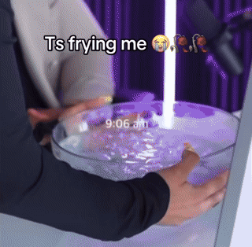
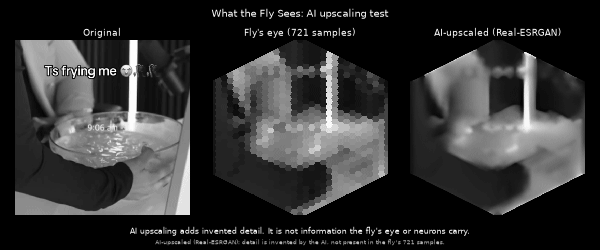
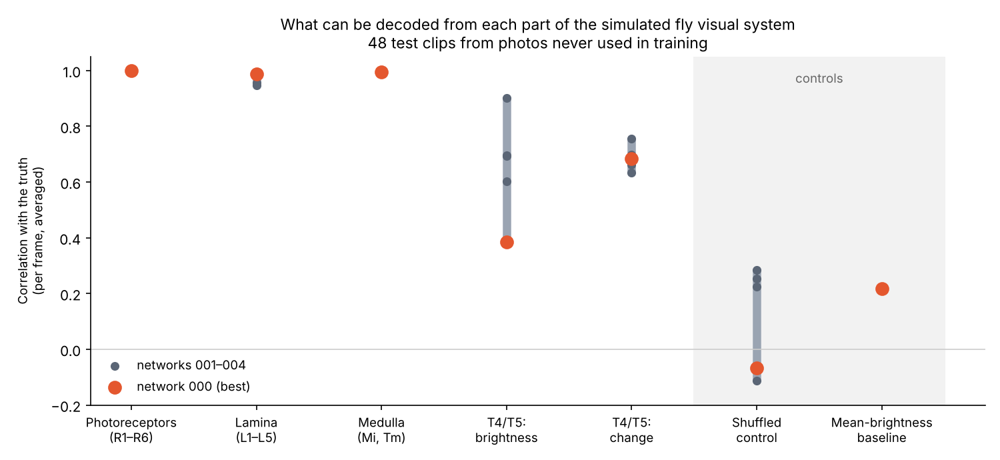

# Demo: What the Fly Sees

Our clip, run through the fly's-eye model from **flyvis** (Lappalainen et al., Nature 2024): each frame is sampled onto the 721 hexagonal columns of a fruit fly's compound eye.

## The clip

[Full clip (mp4, 35 s)](original_clip.mp4)

## How coarse is the fly's eye?

721 samples vs 152,881 pixels (about 212× fewer).

## AI upscaling test

[Video (mp4)](ai_enhanced.mp4) · [Still frame (png)](ai_enhanced_still.png)

Left to right: the original clip, the fly's-eye view (721 samples), and the fly's-eye view upscaled by a pretrained AI super-resolution model (Real-ESRGAN). **Any sharper detail in the AI panel is invented by the AI** from its training on natural photos. It is not information the fly's eye carries.

## What the simulated neurons carry

How well a linear decoder recovers the picture from each stage of the simulated pathway, on photos never used in training (flyvis network 000 in orange, networks 001–004 in gray). The picture survives the lamina and medulla almost intact. The T4/T5 motion detectors carry brightness *change* (0.63–0.76) more reliably than brightness itself. Details are in the [main README](../README.md#results).

These decoders were trained and tested on photo-based clips. A decoded-from-neurons reconstruction of our own clip isn't included yet.

---

| File | Made by |
|---|---|
| `original_clip.gif` / `.mp4` | our footage (grayscale crop happens in `prep_clips.py`) |
| `coarseness.png` | `coarseness.py` |
| `ai_enhanced.gif` / `.mp4` / `_still.png` | `enhance_flyeye.py` |
| `decoder_scores.png` | `fly_vision_run/summarize.py` |
