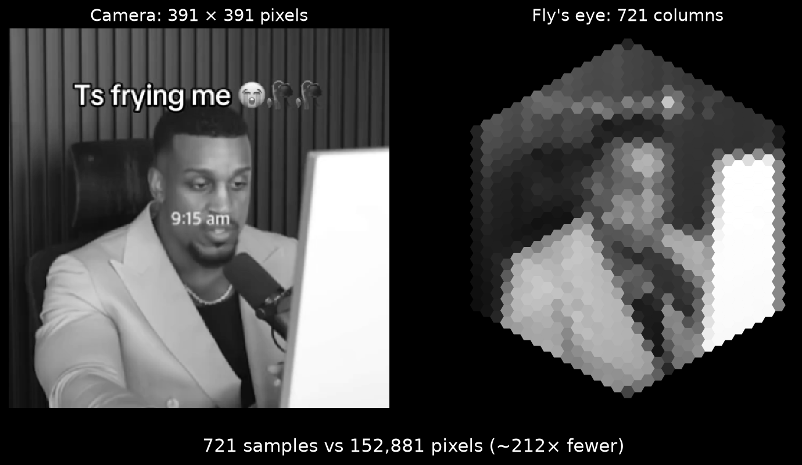
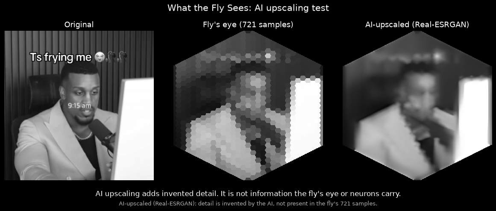

# Demo: What the Fly Sees

Everything here is generated by the scripts in the repo root. The reconstructions are **decoded from simulated neurons** (the flyvis connectome model of the fruit fly's motion-vision pathway). They show what visual information survives in the model, **not what the fly experiences**.

## Main demo

[Full-resolution video (mp4)](what_the_fly_sees.mp4)

Panels, left to right: the original clip | the clip as the fly's eye samples it (721 hexagonal columns) | decoded from photoreceptors (R1–R6) | decoded from the T4/T5 motion detectors. Comparing the last two shows what the motion pathway throws away: moving edges survive, still areas fade.

## How coarse is the fly's eye?

721 samples vs 152,881 pixels (about 212× fewer).

## Control: a still scene

[Still-scene video (mp4)](still_scene.mp4)

The same layout for a scene with no motion. The motion-detector panel should stay close to flat; detailed output there would mean the decoder is painting from memory rather than reading the neurons.

## Add-on: AI upscaling test

[AI upscaling video (mp4)](ai_enhanced.mp4)

A pretrained super-resolution model (Real-ESRGAN) applied to the fly's-eye image, compared with plain bicubic upscaling. **Any sharper detail in the AI panel is invented by the AI** from its training on natural photos. It is not information the fly's eye or the simulated neurons carry.

---

### Files this page expects

| File | Made by |
|---|---|
| `what_the_fly_sees.gif` / `.mp4` | `make_demo.py` (needs the real `results/demo_payload.npz`) |
| `still_scene.mp4` | `make_demo.py --still` |
| `coarseness.png` | `coarseness.py` |
| `ai_enhanced_still.png` / `ai_enhanced.mp4` | `enhance_flyeye.py` |

Copy them from the shared Drive folder `fly_sees/demo/` into this folder. Don't commit the `FAKE_*` layout-test files or `ai_frames.npy`.
